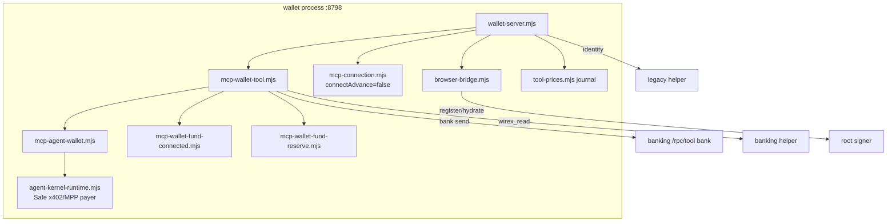
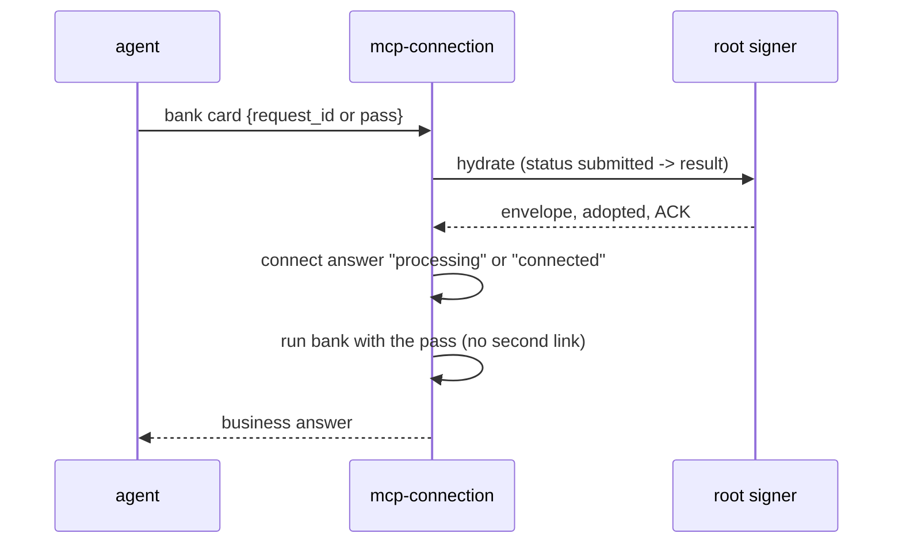

# Architecture

## Custody

Two custody versions run side by side:
1. **v1 (`nuri-privy-app-2of2`, `src/server-boot-check.mjs:28`)**: The agent Safe uses a Privy 2-of-2 agent signer. Before the person connects, the caller holds the `wallet_key`. A connect tap claims the guest Safe via `walletLocal.onTap` (`src/mcp-connection-effects.mjs:42-47`, `src/wallet-server.mjs:73-75`), or as helper `on_tap` (`src/wallet-server.mjs:140-151`), recovering the agent key under `agentSignerSignature` (`src/signer-broker-hook.mjs:55`).
2. **v2 (`nuri-passkey-prf-v1`, `src/server-boot-check.mjs:28`)**: Vendor-independent Nuri Passkey PRF child keys (`src/mcp-wallet-prf-v2.mjs`) co-signed over loopback HTTP by the **100% Rust** `nuri-agent-cosigner` (`AGENT_COSIGNER_URL`, `127.0.0.1:8794`) on Base 2-of-4 Safe v1.5.0 + Arkade VTXOs or Pure-L1 2-of-2 MuSig2+CSV (`src/agent-l1-fronter-v2.mjs`).

The split wallet never consolidates older wallets (`consolidate: false`,
`src/wallet-server.mjs:112-114`, `src/mcp-wallet-tool.mjs:207`).

## Owned stores (single writer)

All core tables sit in one SQLite file, `SHORT_LINKS_DB` (`src/wallet-server.mjs:69`), with chain sidecars and an L1 fronter sidecar next to it. Agent signer records are in `AGENT_STORE_PATH` (`src/privy-agent-app-signer.mjs:93`).

| Table | Writer |
|---|---|
| connection_sessions | `src/browser-session-store.mjs:24` |
| short_links | `src/short-links.mjs:23` |
| agent_kernel_alpha_ops/_txs/_budget/_exit | `src/agent-kernel-runtime.mjs:153-166` |
| agent_wallets, agent_kernel_wallets, agent_provision_intents | `src/agent-wallet-store.mjs:145,181,235` |
| agent_kernel_access/_pending/_tap/_key_box | `src/mcp-agent-wallet.mjs:233-245` |
| wallet_connected_funds | `src/mcp-wallet-fund-connected.mjs:66` |
| agent_spend_events, spend_policy, spend_policy_requests (`safe:<address>` keys) | `src/spend-policy.mjs:63-79` |
| tool_charges | `src/tool-prices.mjs:109` |
| nuri_prf_grant_sessions, nuri_prf_agent_wallets, nuri_prf_lnurl_handles, nuri_prf_lightning_receives, nuri_prf_agent_ops | `src/prf-agent-wallet-store.mjs` (v2 Passkey PRF + Safe + Arkade/Lightning) |
| nuri_l1_fronter_ledger, nuri_l1_fronter_swaps, nuri_l1_trusted_utxos (`${SHORT_LINKS_DB}.l1-fronter` sidecar) | `src/agent-l1-fronter-v2.mjs:564,571,603`, `src/mcp-wallet-prf-v2.mjs:202` |

See [`docs/CUSTODY-EVOLUTION.md`](docs/CUSTODY-EVOLUTION.md) for the complete v1 (`Privy + ZeroDev`)
to v2 (`Nuri Passkey PRF + nuri-agent-cosigner`) custody comparison, and
[`docs/AGENT-DERIVATION-SPEC.md`](docs/AGENT-DERIVATION-SPEC.md) for the frozen derivation strings,
2-of-4 Safe v1.5.0 `CREATE2` prediction, and 3-leaf Arkade server-decay Tapscript specification.

**Chain & L1 fronter sidecars.** For every payable chain other than the home chain, the Safe ledger opens a
separate file named `${SHORT_LINKS_DB}.chain-<chainId>` (`src/mcp-agent-wallet.mjs:222-226`).
The payable chains are listed in `src/safe-pay-chains.mjs:39`. Each sidecar has its own
`agent_kernel_alpha_*` tables (`src/agent-kernel-runtime.mjs:151-166`). In `l1_0conf` mode, Pure-L1 fronter state lives in `${SHORT_LINKS_DB}.l1-fronter` (`src/mcp-wallet-prf-v2.mjs:202`). Sidecars live next to the
main file and belong to the wallet service.

## Peers (loopback only, `src/service-rpc.mjs:51`)

| Call | Target | Peer down |
|---|---|---|
| `fund` top-up from the bank account: `bank.send` to the Safe | banking `bank` | refused connection = `failed`, nothing sent; any later cut = `unknown`, repeat the same `request_id` (`src/service-rpc.mjs:56-66`) |
| reserve in `balance`: `wirex_read` getUserV2/getWallet | banking `helper` | `readReserve` gives `null` and the balance answers without a reserve (`src/mcp-wallet-tool.mjs:262-282`) |
| identity handoff for a pass minted elsewhere | banking, legacy `helper` | the pass stays unknown here, so the answer is the normal connect link (`src/identity-handoff.mjs:55-75`) |
| root signer broker | `ROOT_SIGNER_URL` | unset: no broker, links use the local callback (`src/signer-broker-hook.mjs:23-24`, `src/wallet-server.mjs:109`). Set but down: a new connect answers `failed`, `broker_unreachable: The sign-in service is not answering. Nothing was sent. Try again in a moment.` (`src/mcp-connection.mjs:268,423`), no link. Hydrate errors are only logged (`:347`). Guest claim links from `wallet balance` register the same way (`src/mcp-wallet-tool.mjs:309-313`) and hydrate on the next call (`src/mcp-connection.mjs:283-290`, `src/mcp-wallet-tool.mjs:476-477`). Cloud probe directory-wave-consumer-fix signerdown 6/6 |
| policy co-signer (100% Rust) | `AGENT_COSIGNER_URL` (`127.0.0.1:8794`) | v2 grant registration, Safe co-signing, Arkade signing, and L1 `/v1/l1/*` fail closed with explicit cosigner error (`src/agent-cosigner-client.mjs`) |

Calls served to peers: `wallet` (+`pay_fee`) and `helper` ops `identity`, `safe_address`,
`charge`, `remember`, `on_tap`, `l1_pool_status`, plus `bridge` replay for forwarded callbacks
(`src/wallet-server.mjs:132-164`).

## Not here

Bank-root pay (`wallet_payments`, buy-connect links) belongs to banking. On this service a
`/connection` for a buy link answers `409 payment_continuation_unavailable`, and an `mcp_wallet_pay`
callback answers `payment_continuation_blocked` (`src/wallet-server.mjs:318,328-330`). This
matches the monolith's wallet role.

## Sign-in continuity (directory wave, 2026-10-14)

- A delivered broker result is adopted during the first call (`src/mcp-connection.mjs:339`); the
  answer is `processing` while the account advance runs (`:377,387`). That answer counts as approved:
  the request_id continuation (`:220`) and the session catch path (`:252-262`) run the tool once with
  the pass. After a restart the pass secret is not in RAM (`src/mcp-session.mjs:45`), so the caller's
  own pass is used and re-verified by the tool (`:253`). Before this, the first call answered
  `connect_required` once (combined-qa F2).
- Broker down: `broker_unreachable` (`src/root-signer-client.mjs:23`) is caught (`:268`) and answered as
  one sentence with the code kept (`:423`); no link, no effect. The pending row written before the
  failed register stays, as before.
