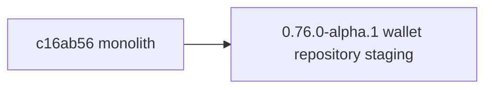

# Changelog

## Unreleased — instant-wallet first-call wording (2026-10-28)

- Remove the duplicate `operator_admission_budget_exhausted` reason key: the later payment text ("same request_id") overwrote the creation text, and a new inner wallet creation has no request id to repeat (live 2026-10-28, `src/mcp-wallet-tool.mjs:81`, `:91`).
- Tool description, `balance` action, `new` and `wallet_key` now state the instant first call: `balance` with `new:true`, no `wallet_key`, no session, no signup; `wallet_key` always only after the first answer (`src/mcp-wallet-tool.mjs:124,129-130,141`).
- Bare `balance` (`askFirst`) names that exact call instead of asking "new or existing?" (`src/mcp-wallet-merge.mjs:36-37`).
- `scripts/check-wallet-ask.mjs` asserts the single reason mapping, the creation-correct sentence without `request_id`, and the instant-call wording in schema and bare answer.

## Unreleased — wallet ask with session (2026-10-18)

- wallet ask accepts the person's session as well as a wallet_key, like pay does (live 2026-10-18: a connected person got 'Ask needs wallet_key').

## Unreleased — weak-model round 3 (2026-10-17)

- Add wallet ask: bounded router AI calls using the existing durable pay transport, with fast/smart quality, answer, USDC cost and receipt.
- Weak-model round 3 (2026-10-17; Emin; Hermes): wallet titled as the AGENT's own USDC wallet, not the person's bank; bridge is never a currency swap.

## Unreleased — model clarity (2026-10-17)

- Model clarity (2026-10-17; source Emin; implementer Hermes): instructions name only the wallet tool and point to banking.paymentrequired.com/mcp for account and bank; "not tapped yet" and second-tap answers worded apart; bridge dead-end says ask for a new link.

## Guest claim crash recovery and caller budget, 2026-10-16 (source Emin; Hermes/GPT-6.1; unreleased)

- Code `8bccca2040c825f3041c735eb44ad089be30c48a`, committed 2026-10-16T04:06:48+02:00.
- Local owner and encrypted guest-key box commit together before broker approval/ACK, without invoking the hand-over;
  approved replay participates in recovery (`src/mcp-agent-wallet.mjs:394-416`, `src/browser-bridge.mjs:484-543`,
  `src/browser-session-store.mjs:51-65`). Old ACK-cleared, unapplied approvals may remain unrecoverable; no secret/order invented.
- Complete candidate scans carry independent caller cancellation/deadline budgets through broker reads; exhaustion
  remains pending without selecting a partial candidate set (`src/signer-broker-hook.mjs:88-186`, `src/root-signer-client.mjs:17-54`).
- Static `git diff --check` passed. Runtime, cloud checks/build and crash/cancellation assertions UNVERIFIED.
  No Mac product execution, new repository tests, Signer/Banking edits, provider calls, push or deploy. Parent owns release.

## Retained broker claim ordering/recovery, 2026-10-16 (source Emin; implementer Hermes/GPT-6.1; unreleased, not deployed)

- Code `e06df06c12e0d5e35b4631ca9866fdfb65c63ee8`, committed 2026-10-16T03:33:17+02:00.
  Supersedes timestamp election below: authenticated status/result `submitOrder` must match and be a positive safe
  integer; the least order wins after both scans. Unknown historical order, duplicate earliest order or unreadable
  candidates fail closed, without ACK (`src/signer-broker-hook.mjs:117-168`, `src/root-signer-client.mjs:62-70`).
- Retain pending broker guest-claim descriptors after local expiry; reload without an expired ephemeral key and allow
  hydration from session/request_id paths (`src/browser-session-store.mjs:51-73`, `src/browser-bridge.mjs:662-670,718-721`,
  `src/mcp-connection.mjs:285-290,346-350`). Existing wallet_key discovery uses the same election.
- `approvedAt` still gates original approval/signing expiry; envelope bindings, signatures, persist-before-ACK and
  effects remain in the existing adoption pipeline (`src/browser-bridge.mjs:484-530`, `src/signer-broker-hook.mjs:104-114`).
- Requires coordinated Signer code `19f2c459f83d2a84d4d25c191c630ab579ca967d`: additive internal submit counter/column,
  response metadata and wallet-connect ciphertext retention until ACK. No public MCP input schema/version change.
  Historical unknown order and already-purged data remain unresolved; full parity, cloud checks/build/runtime/deploy
  UNVERIFIED. No product execution on Mac. Parent owns execution and release.

## Wallet parity v3, code b986f09a8a43a669140cf8c6c61618a65c78b4bb, 2026-10-16 (source Emin; implementer Hermes/Opus 5.5; unreleased, not deployed)

- Supersedes the creation-order/newest-32 behavior described below. Discover all pending unexpired broker claim rows,
  select the least broker `approvedAt` after a second unresolved-link scan, and share the election across session,
  request_id and wallet_key entry points (`src/browser-session-store.mjs:52-61`, `src/signer-broker-hook.mjs:94-97,117-166`).
- Unreadable results, unknown status, metadata mismatch and equal earliest timestamps stop adoption; no later-owner
  fallback or ACK. Existing envelope/signature/binding/expiry/replay validation and persist-before-ACK stay in the bridge
  (`src/signer-broker-hook.mjs:104-114,141-165`, `src/browser-bridge.mjs:484-530`).
- Broker HTTP headers/body share a 3 s deadline; errors suppress further network calls through this client for 5 s,
  including balance's subsequent registration (`src/root-signer-client.mjs:14-54`). Runtime timing UNVERIFIED.
- Exact first-tap parity remains contract-blocked: Signer uses millisecond `Date.now()` without a total-order token and
  deletes submitted results after 300 s (sibling approved source `paymentrequired-signer/src/root-signer-store.mjs:25,33,53-54`,
  `paymentrequired-signer/src/root-signer-envelope.mjs:17`). Ties fail closed; lost results cannot be reconstructed.
  No broker contract change made. Clock monotonicity, expired-session retention and end-to-end behavior UNVERIFIED;
  parent cloud check/build/fixtures required. No product execution on Mac, deploy, live signatures or payments.

## Signer parity follow-up: durable guest claim links, code 9e9fe4677558, 2026-10-16 (source Emin; Hermes/Opus 5.5; unreleased, not deployed)

- RAM `claimLinks` removed. wallet_key balance on an unclaimed wallet now hydrates every stored pending broker-bound
  claim row of that wallet (`context.walletId`), oldest first, stops at the first approved one
  (`src/browser-session-store.mjs:52-63,69-71`, `src/signer-broker-hook.mjs:109-121`, `src/mcp-wallet-tool.mjs:478-480`).
  Survives restart and newer links, like the local callback.
- Broker register failure: no link (never a wallet-local one), logged `root_signer_register_failed`, next sentence says retry
  (`src/mcp-wallet-tool.mjs:308-309,505`).

## Signer parity: guest claim link, code a7e7f189d7c1, 2026-10-16 (source Emin; Hermes/Opus 5.5; unreleased, not deployed)

- `wallet balance` guest claim link now registers with the root signer like connect_wallet, so with `ROOT_SIGNER_URL` set it
  is the signer's `/bridge/privy?request_id&state` link, not wallet-local (`src/mcp-wallet-tool.mjs:309-313`, `src/wallet-server.mjs:103,108`).
- Its tap is adopted by broker hydrate on the next call: session calls (`src/mcp-connection.mjs:283-290`) and wallet_key-only
  balance before finishTap (`src/mcp-wallet-tool.mjs:476-477`); bridge effects then run onTap as for a local tap.
- Unset `ROOT_SIGNER_URL`: unchanged local link and callback. Existing local rows keep their URLs.

## Dockerfile layer optimization, 2026-10-14 (Hermes subagent for Emin, unpublished)

- Build stage copies sources first and runs one layer: `npm ci --include=dev && npm run build:privy && npm prune --omit=dev && npm cache clean --force`. The dev dependency tree is never
  committed as its own layer (legacy builder failed the old install layer: inode exhaustion). Manifests, lock, source,
  runtime stage, USER and CMD unchanged. NOT built yet: host inode headroom unsafe after facade (layer-optimized-images/result.json).

## directory-wave consumer fix, 2026-10-14 (input: frozen directory-wave copy, tree 85e926cb…; Hermes subagent for Emin)

- First call after an already delivered broker result no longer answers `connect_required`
  once: an approved `processing` connect answer runs the tool (`src/mcp-connection.mjs:220,252-264`).
- Broker down answers `broker_unreachable: The sign-in service is not answering. Nothing was sent. Try again in a moment.`
  instead of `fetch failed` (`src/mcp-connection.mjs:268,423`).
- `/mcp` is this service's public endpoint; role page and docs name `wallet.paymentrequired.com/mcp`.

## 0.76.0-alpha.1: 2026-10-14, staging (unpublished)

- Extracted from source c16ab56fdc95c09982c14dfc8d6b89994a8107df; parity head 8e77eecc reviewed, no wallet-owned delta.
- Own entrypoint `src/wallet-server.mjs`, manifest, lockfile (source lock minus `@zerodev/weighted-validator` subtree), Dockerfile.
