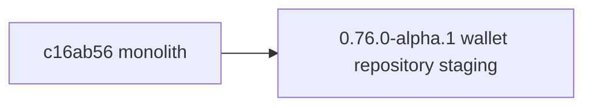

# Changelog

## Unreleased — Keep `/skill.md` & `/llms.txt` setup simple and browser-Passkey-first (2026-11-24)

- Keep `## Setup` in `/skill.md` and `/llms.txt` (`src/service-index.mjs`) strictly simple and browser-Passkey-first so normal AI agents are never confused by hardware-wallet steps; move optional `nuricard connect` note to a 1-line Companion Services footnote (only if the user explicitly uses `nuricard`), while keeping `lnurl_username` (`username@nuriwallet.com`) documented under `balance` / `receive`.

## Unreleased — Hardware-first smartcard/FIDO2 onboarding cascade in `/skill.md` & `/llms.txt` (2026-11-24)

- Update `/skill.md` and `/llms.txt` (`src/service-index.mjs`) so AI agents check for a connected PC/SC Nuri Smartcard or USB-HID FIDO2 security key first (`nuricard connect --probe` / `nuricard connect <approval_url>` — zero browser/extension, native OS PIN prompt) and fall back to browser Passkey `approval_url` only when no hardware key is present; also document `lnurl_username` (`username@nuriwallet.com`) registration and `lnurl` reporting in `balance`.

## Unreleased — Report registered `username@nuriwallet.com` LNURL in wallet balance & receive (2026-11-24)

- Include registered `lnurl` (`username@nuriwallet.com`, plus `lnurl_addresses` if multiple) in `readDualBalances`, `dualBalanceSummary`, and BTC/Arkade/Lightning `receive` responses (`src/mcp-wallet-prf-v2.mjs`), and tailor LNURL registration confirmation text for `l1_0conf` mode.

## Unreleased — Document L1 0-conf Arkade fronter findings, env vars & `nuri-expo` proof (2026-11-24)

- Add `docs/L1-0CONF-ARKADE-FRONTER.md` documenting the Muun-model pure-L1 2-of-2 MuSig2+CSV +
  server-only Arkade liquidity pool architecture, Muun `apollo` 1-sat verification (`LEND`/
  `COLLECT`/`FulfillFullDebt`), live `@arkade-os/sdk@0.5.8` & `@arkade-os/swap@0.1.8` fixes,
  live `46.225.135.119` `blocks: 4320` CSV sync, concurrency/crash hardening, `FRONTER_*`
  environment variables, and zero-divergence `app.nuri.com` (`nuri-expo`) compatibility proof.
- Add Pure-L1 0-Conf Arkade Fronter configuration, `l1_pool_status` RPC, and `/healthz` surface
  section to `README.md`.

## Unreleased — Hardened L1 0-conf Arkade Fronter: real SDK fixes, crash reconciler, concurrency & CSV recovery (2026-11-24)

- Live-sync `nuri_server_csv` and `l1_network` from `nuri-agent-cosigner /healthz` so derived `bc1p...`
  addresses always match live cosigner configuration (e.g. `blocks: 4320` on `46.225.135.119`).
- Fix `@arkade-os/sdk@0.5.8` / `@arkade-os/swap@0.1.8` server pool runtime calls (`derivePoolLightningSendLockup`
  with exact `lightningSendContract` params + `preTimelockedRefund` legacy fallback + `verifyLockupAddress(quote, candidates)`,
  `fate === "returned" | "exited"`, `pushClaim` pagination loop, `v.isSwept` filter, `resolveEmulatorPubkey` empty-string
  guard, `FRONTER_L1_DEPOSIT_ADDRESS` precedence, and `l1_pool_status` loopback RPC helper).
- Add per-wallet & pool async mutexes + pool L1 hot-wallet change tracking, atomic SQLite inbound claim reservation
  (eliminating concurrent double payouts and non-fatal cosigner trust-register loops), crash-safe `broadcast_pending`
  reconciler, timeout lock preservation (never releasing L1 locks while VHTLC is live), cosigner `/v1/l1/authorize-spend`
  for `LEND` / `micro_credit`, `maxSats` enforcement including L1 miner fees, ancestor-depth cap (<=20), stale trusted
  UTXO pruning, `buildUserCsvRecoveryTx` unilateral Tapscript CSV exit, and multi-scheme `WWW-Authenticate` parsing fix.

## Unreleased — Muun-model Pure-L1 2-of-2 MuSig2+CSV + Server-Only Arkade 0-Conf Fronter (2026-11-24)

- Add `src/agent-l1-fronter-v2.mjs` (`createAgentL1FronterRuntime`, `deriveAgentL1Wallet`,
  `createServerArkadeLiquidityPool`, `openL1FronterLedger`) implementing pure on-chain L1
  `tr(MuSig2(agent, cosigner), pk(agent) + CSV)` user wallets backed by a **single** server-side
  Arkade + L1 liquidity pool (zero per-user Arkade VTXOs, zero client VTXO renewal/exit chains).
- Outgoing L1 → Lightning: Muun-style `LEND` (tiny sends `<= FRONTER_LEND_MAX_SATS` settle
  instantly via server Arkade with 0 L1 tx, zero user custody risk), `COLLECT` + cosigner-locked
  hold-broadcast for larger sends (broadcasts signed L1 replenishment tx only after LN preimage;
  releases outpoint lock with 0 L1 fee if LN fails), plus trusted 0-conf self-change chaining.
- Incoming Lightning → User L1 `bc1p...`: Muun-style `FulfillFullDebt` debt cancellation first
  (0 L1 tx), instant 0-conf L1 P2TR payout above `FRONTER_L1_SETTLE_FLOOR_SATS` (registered
  trusted 0-conf on `nuri-agent-cosigner` for immediate re-spend), and micro-receive auto-sweep
  below floor.
- Direct 1-tx native L1 MuSig2 send for `bc1...`/BIP21 addresses (`payOnchainBtc`), cosigner
  `/v1/l1/*` RPC methods (`src/agent-cosigner-client.mjs`), `AGENT_BTC_CUSTODY_MODE=l1_0conf`
  runtime switch (`src/mcp-wallet-prf-v2.mjs`, `/healthz` capability flag in `src/wallet-server.mjs`),
  and offline E2E suite `scripts/check-l1-0conf-fronter.mjs` wired into `npm run check:prf`.

## Unreleased — Seamless Base USDC / Arkade -> Tempo MPP auto-bridge via Relay (2026-11-23)

- Auto-fund Tempo mainnet (`4217`) MPP calls from **Base USDC** (or **Arkade/Lightning** via
  existing Arkade → Base USDC bridge) using Relay's deposit-address flow (`POST /quote`,
  `useDepositAddress: true`) straight to the wallet's **Agent EOA** (`src/mcp-wallet-prf-v2.mjs`,
  `src/agent-lightning-pay.mjs`, `src/safe-pay-mpp.mjs`). Strictly verifies Relay origin chain,
  Base USDC token address, ERC-20 `transfer(depositAddress, amount)` calldata, and fee ceiling
  before signing a plain Base Safe USDC transfer (no Tempo Safe deployment or cosigner changes
  needed).
- Lower Tempo EOA gas buffer from `$2.00` to `$0.003` (`3_000n`, ~10x live Tempo `transferWithMemo`
  gas), enforce Relay's `$0.055` (`55_000n`) minimum deposit-address quote floor so tiny top-up
  shortfalls never fail with `< 50000`, reuse any existing Tempo balance on the Agent EOA before
  hopping or bridging, and reflect Base-funded Tempo payability in `dry_run`.

## Unreleased — Tempo MPP feeToken & two-step credit-proof fix (2026-11-23)

- Fix `ensureSafeDeployed` missing `feeToken` parameter when deploying a counterfactual PRF Safe
  on Tempo (`src/agent-safe-v2.mjs`) and expose `readTokenBalanceUnits` for chain-accurate Tempo
  balance checks.
- Skip on-chain Safe → Agent EOA hops for zero-amount MPP EIP-712 credit-proof challenges
  (`src/safe-pay-mpp.mjs`), and handle two-step MPP credit-proof → `402 credit_insufficient` →
  paid-challenge retry with cap enforcement and Tempo balance checks (`src/agent-lightning-pay.mjs`,
  fixing `treg.to` MPP challenges).

## Unreleased — 24h PRF passkey connect links (2026-11-23)

- Pass explicit `timeout_ms` (default 24 h via `DEFAULT_GRANT_CONNECT_TIMEOUT_MS`, overridable
  via `PRF_GRANT_CONNECT_TIMEOUT_MS`, including `0` for no deadline) from `startOrPollOnboarding`
  to `connect.nuri.com`'s `wallet_sign_start` (`src/mcp-wallet-prf-v2.mjs`) instead of omitting
  `timeout_ms` and falling back to Connect's 60-minute `WALLET_SIGN_TTL_MS`.
- Handle Connect's `expires_at: 0` no-deadline sentinel in `parseSessionExpiresAtMs` (previously
  fell through to `Date.parse("0")` → Jan 1, 2000) and raise missing-expiry fallback from 15 min
  to 24 h (`src/prf-agent-wallet-store.mjs`).

## Unreleased — Tempo MPP + nuriwallet.com LNURL (2026-11-20)

- Tempo-chain MPP offers (4217/42431) are payable from the PRF Safe: same counterfactual
  Safe address on Tempo, relayer pays Safe-exec/deploy fees in the token itself, Agent EOA
  pays `transferWithMemo` from a hopped fee reserve (`0e538e2`, PR #23, live 2026-11-20).
- `username@nuriwallet.com` LNURL-pay Lightning addresses for PRF wallets: handle registry
  with server-sealable receive root, public `/.well-known/lnurlp/:u` + `/lnurl/callback/:u`
  (every wallet origin, callback pinned to `https://nuriwallet.com/...`), registration via
  `wallet receive lnurl_username=…`, unattended claim sweeper into the 2-of-2 Arkade VTXO
  (`238810d`, PR #24 + sweeper seconds-vs-ms fix PR #25, live 2026-11-20:
  `goose@nuriwallet.com` minted a real 5000-sats BOLT11 via the RFQ solver, payment-hash
  claimability verified).

## Unreleased — wallet ask with session (2026-10-18)

- wallet ask accepts the person's session as well as a wallet_key, like pay does (live 2026-10-18: a connected person got 'Ask needs wallet_key').

## Unreleased — weak-model round 3 (2026-10-17)

- Add wallet ask: bounded router AI calls using the existing durable pay transport, with fast/smart quality, answer, USDC cost and receipt.
- Weak-model round 3 (2026-10-17; Emin; Hermes): wallet titled as the AGENT's own USDC wallet, not the person's bank; bridge is never a currency swap.

## Unreleased — model clarity (2026-10-17)

- Model clarity (2026-10-17; source Emin; implementer Hermes): instructions name only the wallet tool and point to banking.paymentrequired.com/mcp for account and bank; "not tapped yet" and second-tap answers worded apart; bridge dead-end says ask for a new link.

## Guest claim crash recovery and caller budget, 2026-10-16 (source Emin; Hermes/GPT-6.1; unreleased)

- Code `8bccca2040c825f3041c735eb44ad089be30c48a`, committed 2026-10-16T04:06:48+02:00.
- Local owner and encrypted guest-key box commit together before broker approval/ACK, without invoking the hand-over;
  approved replay participates in recovery (`src/mcp-agent-wallet.mjs:394-416`, `src/browser-bridge.mjs:484-543`,
  `src/browser-session-store.mjs:51-65`). Old ACK-cleared, unapplied approvals may remain unrecoverable; no secret/order invented.
- Complete candidate scans carry independent caller cancellation/deadline budgets through broker reads; exhaustion
  remains pending without selecting a partial candidate set (`src/signer-broker-hook.mjs:88-186`, `src/root-signer-client.mjs:17-54`).
- Static `git diff --check` passed. Runtime, cloud checks/build and crash/cancellation assertions UNVERIFIED.
  No Mac product execution, new repository tests, Signer/Banking edits, provider calls, push or deploy. Parent owns release.

## Retained broker claim ordering/recovery, 2026-10-16 (source Emin; implementer Hermes/GPT-6.1; unreleased, not deployed)

- Code `e06df06c12e0d5e35b4631ca9866fdfb65c63ee8`, committed 2026-10-16T03:33:17+02:00.
  Supersedes timestamp election below: authenticated status/result `submitOrder` must match and be a positive safe
  integer; the least order wins after both scans. Unknown historical order, duplicate earliest order or unreadable
  candidates fail closed, without ACK (`src/signer-broker-hook.mjs:117-168`, `src/root-signer-client.mjs:62-70`).
- Retain pending broker guest-claim descriptors after local expiry; reload without an expired ephemeral key and allow
  hydration from session/request_id paths (`src/browser-session-store.mjs:51-73`, `src/browser-bridge.mjs:662-670,718-721`,
  `src/mcp-connection.mjs:285-290,346-350`). Existing wallet_key discovery uses the same election.
- `approvedAt` still gates original approval/signing expiry; envelope bindings, signatures, persist-before-ACK and
  effects remain in the existing adoption pipeline (`src/browser-bridge.mjs:484-530`, `src/signer-broker-hook.mjs:104-114`).
- Requires coordinated Signer code `19f2c459f83d2a84d4d25c191c630ab579ca967d`: additive internal submit counter/column,
  response metadata and wallet-connect ciphertext retention until ACK. No public MCP input schema/version change.
  Historical unknown order and already-purged data remain unresolved; full parity, cloud checks/build/runtime/deploy
  UNVERIFIED. No product execution on Mac. Parent owns execution and release.

## Wallet parity v3, code b986f09a8a43a669140cf8c6c61618a65c78b4bb, 2026-10-16 (source Emin; implementer Hermes/Opus 5.5; unreleased, not deployed)

- Supersedes the creation-order/newest-32 behavior described below. Discover all pending unexpired broker claim rows,
  select the least broker `approvedAt` after a second unresolved-link scan, and share the election across session,
  request_id and wallet_key entry points (`src/browser-session-store.mjs:52-61`, `src/signer-broker-hook.mjs:94-97,117-166`).
- Unreadable results, unknown status, metadata mismatch and equal earliest timestamps stop adoption; no later-owner
  fallback or ACK. Existing envelope/signature/binding/expiry/replay validation and persist-before-ACK stay in the bridge
  (`src/signer-broker-hook.mjs:104-114,141-165`, `src/browser-bridge.mjs:484-530`).
- Broker HTTP headers/body share a 3 s deadline; errors suppress further network calls through this client for 5 s,
  including balance's subsequent registration (`src/root-signer-client.mjs:14-54`). Runtime timing UNVERIFIED.
- Exact first-tap parity remains contract-blocked: Signer uses millisecond `Date.now()` without a total-order token and
  deletes submitted results after 300 s (sibling approved source `paymentrequired-signer/src/root-signer-store.mjs:25,33,53-54`,
  `paymentrequired-signer/src/root-signer-envelope.mjs:17`). Ties fail closed; lost results cannot be reconstructed.
  No broker contract change made. Clock monotonicity, expired-session retention and end-to-end behavior UNVERIFIED;
  parent cloud check/build/fixtures required. No product execution on Mac, deploy, live signatures or payments.

## Signer parity follow-up: durable guest claim links, code 9e9fe4677558, 2026-10-16 (source Emin; Hermes/Opus 5.5; unreleased, not deployed)

- RAM `claimLinks` removed. wallet_key balance on an unclaimed wallet now hydrates every stored pending broker-bound
  claim row of that wallet (`context.walletId`), oldest first, stops at the first approved one
  (`src/browser-session-store.mjs:52-63,69-71`, `src/signer-broker-hook.mjs:109-121`, `src/mcp-wallet-tool.mjs:478-480`).
  Survives restart and newer links, like the local callback.
- Broker register failure: no link (never a wallet-local one), logged `root_signer_register_failed`, next sentence says retry
  (`src/mcp-wallet-tool.mjs:308-309,505`).

## Signer parity: guest claim link, code a7e7f189d7c1, 2026-10-16 (source Emin; Hermes/Opus 5.5; unreleased, not deployed)

- `wallet balance` guest claim link now registers with the root signer like connect_wallet, so with `ROOT_SIGNER_URL` set it
  is the signer's `/bridge/privy?request_id&state` link, not wallet-local (`src/mcp-wallet-tool.mjs:309-313`, `src/wallet-server.mjs:103,108`).
- Its tap is adopted by broker hydrate on the next call: session calls (`src/mcp-connection.mjs:283-290`) and wallet_key-only
  balance before finishTap (`src/mcp-wallet-tool.mjs:476-477`); bridge effects then run onTap as for a local tap.
- Unset `ROOT_SIGNER_URL`: unchanged local link and callback. Existing local rows keep their URLs.

## Dockerfile layer optimization, 2026-10-14 (Hermes subagent for Emin, unpublished)

- Build stage copies sources first and runs one layer: `npm ci --include=dev && npm run build:privy && npm prune --omit=dev && npm cache clean --force`. The dev dependency tree is never
  committed as its own layer (legacy builder failed the old install layer: inode exhaustion). Manifests, lock, source,
  runtime stage, USER and CMD unchanged. NOT built yet: host inode headroom unsafe after facade (layer-optimized-images/result.json).

## directory-wave consumer fix, 2026-10-14 (input: frozen directory-wave copy, tree 85e926cb…; Hermes subagent for Emin)

- First call after an already delivered broker result no longer answers `connect_required`
  once: an approved `processing` connect answer runs the tool (`src/mcp-connection.mjs:220,252-264`).
- Broker down answers `broker_unreachable: The sign-in service is not answering. Nothing was sent. Try again in a moment.`
  instead of `fetch failed` (`src/mcp-connection.mjs:268,423`).
- `/mcp` is this service's public endpoint; role page and docs name `wallet.paymentrequired.com/mcp`.

## 0.76.0-alpha.1: 2026-10-14, staging (unpublished)

- Extracted from source c16ab56fdc95c09982c14dfc8d6b89994a8107df; parity head 8e77eecc reviewed, no wallet-owned delta.
- Own entrypoint `src/wallet-server.mjs`, manifest, lockfile (source lock minus `@zerodev/weighted-validator` subtree), Dockerfile.
