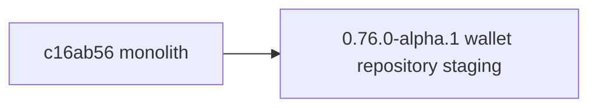

# Changelog

## Signer parity: guest claim link, code a7e7f189d7c1, 2026-10-16 (source Emin; Hermes/Opus 5.5; unreleased, not deployed)

- `wallet balance` guest claim link now registers with the root signer like connect_wallet, so with `ROOT_SIGNER_URL` set it
  is the signer's `/bridge/privy?request_id&state` link, not wallet-local (`src/mcp-wallet-tool.mjs:309-313`, `src/wallet-server.mjs:103,108`).
- Its tap is adopted by broker hydrate on the next call: session calls (`src/mcp-connection.mjs:283-290`) and wallet_key-only
  balance before finishTap (`src/mcp-wallet-tool.mjs:476-477`); bridge effects then run onTap as for a local tap.
- Unset `ROOT_SIGNER_URL`: unchanged local link and callback. Existing local rows keep their URLs.

## Dockerfile layer optimization, 2026-10-14 (Hermes subagent for Emin, unpublished)

- Build stage copies sources first and runs one layer: `npm ci --include=dev && npm run build:privy && npm prune --omit=dev && npm cache clean --force`. The dev dependency tree is never
  committed as its own layer (legacy builder failed the old install layer: inode exhaustion). Manifests, lock, source,
  runtime stage, USER and CMD unchanged. NOT built yet: host inode headroom unsafe after facade (layer-optimized-images/result.json).

## directory-wave consumer fix, 2026-10-14 (input: frozen directory-wave copy, tree 85e926cb…; Hermes subagent for Emin)

- First call after an already delivered broker result no longer answers `connect_required`
  once: an approved `processing` connect answer runs the tool (`src/mcp-connection.mjs:220,252-264`).
- Broker down answers `broker_unreachable: The sign-in service is not answering. Nothing was sent. Try again in a moment.`
  instead of `fetch failed` (`src/mcp-connection.mjs:268,423`).
- `/mcp` is this service's public endpoint; role page and docs name `wallet.paymentrequired.com/mcp`.

## 0.76.0-alpha.1: 2026-10-14, staging (unpublished)

- Extracted from source c16ab56fdc95c09982c14dfc8d6b89994a8107df; parity head 8e77eecc reviewed, no wallet-owned delta.
- Own entrypoint `src/wallet-server.mjs`, manifest, lockfile (source lock minus `@zerodev/weighted-validator` subtree), Dockerfile.
