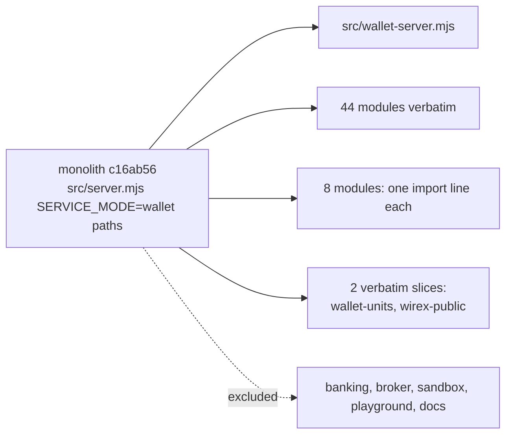

# Extraction record

Source: `nuri-wirex-mcp` at c16ab56fdc95c09982c14dfc8d6b89994a8107df, exported to
`repository-split/source/`. The parity delta c16ab56..8e77eecc changes the legacy facade
(`src/server.mjs` guestLink buy clause), banking's pay module (`src/mcp-wallet-pay.mjs:1333`) and
the adoption tool. None of them is a wallet-owned route, so nothing was ported here. Buy-connect
links follow their payment to banking, and this service refuses them (ARCHITECTURE "Not here").

## Edited files (exact change)

| File | Change |
|---|---|
| `src/browser-bridge.mjs`, `src/mcp-account.mjs`, `src/mcp-connection-effects.mjs`, `src/short-links.mjs` | import from `./wirex-public.mjs` instead of `./wirex-baas.mjs` / `./wirex-api.mjs` |
| `src/mcp-agent-wallet.mjs`, `src/mcp-connection.mjs`, `src/mcp-wallet-fund-connected.mjs`, `src/mcp-wallet-tool.mjs` | import from `./wallet-units.mjs` instead of `./mcp-wallet-pay.mjs` |
| `src/wallet-units.mjs` (new) | verbatim `src/mcp-wallet-pay.mjs` lines 50-65, 74-75, 143-147, 156-158, 162-168, 170-187 |
| `src/wirex-public.mjs` (new) | verbatim `src/wirex-baas.mjs` lines 14-16, 18, 23-25, 27-49, 391-397 and `src/wirex-api.mjs` line 29: constants and error type only, no client |
| `src/wallet-server.mjs` (new) | the `SERVICE_MODE=wallet` branches of `src/server.mjs`, each construction citing its source line |

## Behaviour differences from the monolith's wallet role (observed, cloud probe)

| Item | Monolith `SERVICE_MODE=wallet` | This repository |
|---|---|---|
| `GET /api/browser-sessions/<id>/approval?state=` (the approval page's read, `src/privy-bridge-client.mjs:51-58`) | 500 `Cannot read properties of null (reading 'approvalPayload')`: `mcpWalletPay` is null on the wallet role (source `src/server.mjs:166,499`) | 200 bridge payload via `readApprovalPayload` (`src/wallet-server.mjs:333-341`), the same function the pay module delegates to for non-pay rows (source `src/mcp-wallet-pay.mjs:1597-1599`) |
| loopback `/mcp` `tools/list` | wallet, account, bank (account and bank as remote peers, source `src/server.mjs:202,212-214`) | wallet only *(historical extraction snapshot: `POST /mcp`, `/v1/*`, `/v1/fronter/status`, `/llms.txt`, and `/.well-known/lnurlp/*` were subsequently published across `WALLET_HOSTS`; see `README.md` "Surface")* |

## Excluded (reason)

| Paths | Reason |
|---|---|
| `src/wirex-baas.mjs`, `src/wirex-api.mjs` | Wirex clients and token source belong to banking. The wallet built none (`src/server.mjs:98,122` only under `owns.banking`) |
| `src/mcp-bank*.mjs`, `mcp-account-tool.mjs`, `mcp-cards.mjs`, `mcp-card-*.mjs`, `mcp-payouts.mjs`, `mcp-products.mjs`, `mcp-withdrawals.mjs`, `aa-withdrawal.mjs`, `mcp-transfers.mjs`, `mcp-deposits.mjs`, `mcp-wallets.mjs`, `mcp-balances.mjs`, `mcp-money*.mjs`, `iban-lookup.mjs`, `mcp-activity.mjs`, `mcp-wallet-fund-global.mjs` | banking tools and their writers (`src/server.mjs:155-171,199-214`, all `BANKING ?`) |
| `src/mcp-wallet-pay.mjs` | bank-root pay and `wallet_payments` ledger are banking's (`src/server.mjs:164-166`); only pure helpers kept as `wallet-units.mjs` |
| `src/resend-onboarding.mjs`, `kyc-provision-state.mjs` | banking-only onboarding (`src/server.mjs:136,142`); the wallet's accountFlow uses `authorized`/`completeAuthorization` only |
| `src/privy-agent-playground.mjs`, `payment-agent-funding.mjs` | the `playground` dependency is never read (`src/mcp-wallet-tool.mjs:212` passes it, no reader); the `/api/privy-agent/approval/*` routes serve only `scripts/privy-agentic-poc.mjs` |
| `src/sandbox-x402-resource.mjs` | `SANDBOX_TOOLS=off` in production; not a wallet product route |
| `src/root-signer-broker.mjs`, `root-signer-store.mjs`, `root-signer-delivery.mjs`, `public/root-signer.*` | signer repository |
| `src/docs-guide.mjs`, `mcp-instructions` apex docs, `public/llms*.txt`, `skill.md`, `index.html`, `app/` | apex docs and pages (`src/service-index.mjs:52-53` links to the apex) |
| `src/agent-resource-payment.mjs` | only used for a boot log line (`src/server.mjs:557`) |
| `src/identity-handoff.mjs` peer `wallet` | the wallet is not its own peer (`src/server.mjs:187`) |
| `tools/adopt-state.mjs`, `deploy/`, `scripts/`, `stories/`, `agent-qa/`, `evidence/`, `DECISIONS.md` etc. | migration, deployment composition, QA and history belong to the parent and other repositories |
| `@zerodev/weighted-validator` | imported only by `src/aa-withdrawal.mjs` (banking) |

`src/browser-session-store.mjs` is copied verbatim. Its `createRemoteSignerSessionStore` is not
called here, because the source passed it to `createSignerClient`, which ignores it
(`src/signer-client.mjs:72-76`).

`src/wirex-public.mjs:50` keeps the source's `V1_APP_HOSTS` constant verbatim. `src/short-links.mjs:39`
uses it to refuse shortening retired v1 host links that do not belong to this origin. It is a deny
list and never a call target.
