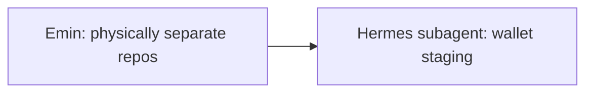

# Prompt log

- 2026-10-16, source Emin via Hermes parent; implementer Hermes/Opus 5.5; Wallet parity v3,
  code b986f09a8a43a669140cf8c6c61618a65c78b4bb: "No arbitrary newest-32 window; earliest successful tap, not oldest
  link creation; verify broker approvedAt; bounded broker response latency and stop repeated outage calls; do not hide
  unreadable potentially-earlier submitted results. Source-only, Wallet clone only, no Mac product execution or deploy."
  Implemented uncapped discovery, two-pass timestamp election shared by entry points, same-wallet in-flight coalescing,
  3 s HTTP/body deadline and 5 s client failure backoff (`src/browser-session-store.mjs:52-61`,
  `src/signer-broker-hook.mjs:94-97,117-166`, `src/root-signer-client.mjs:14-54`). Full parity NOT claimed: equal
  millisecond approvals and broker's 300 s result loss need a concrete signer contract decision (sibling
  `paymentrequired-signer/src/root-signer-store.mjs:25,33,53-54`, `paymentrequired-signer/src/root-signer-envelope.mjs:17`).
  Tests/build/runtime UNVERIFIED; parent cloud gates own execution. No new schemas, dependencies or public tool fields.
- 2026-10-16, Emin via Hermes parent → Hermes/Opus 5.5 (wallet follow-up, code 9e9fe4677558): "Repair the acknowledged parity
  hole: RAM-only claimLinks loses previously issued broker claim results after restart or when a newer balance link replaces it …
  Reuse persisted bridge connection rows/context.walletId … no new store/schema … No push/deploy."
- 2026-10-16, Emin via Hermes parent → Hermes/Opus 5.5 (signer-wallet parity, code a7e7f189d7c1): "Audit and fix verified
  wallet-to-Signer parity seam omissions. Parent live guest balance claim link resolves wallet-local /bridge/privy rather than
  separate signer … local legacy URLs must stay usable … No push/deploy."
- 2026-10-14, Emin via Hermes parent → Hermes subagent (wallet staging): "Implement physically separate Wallet repository artifact for wallet.paymentrequired.com … no Wirex banking constructor/client credentials … cloud actual boot/fixture probes … no prod or publication." Follow-up: port 8e77eecc only where wallet owns the route; preserve `<db>.chain-<id>` sidecar contract.
- 2026-10-14, Emin via Hermes parent → Hermes subagent (directory-wave consumer fix), input frozen directory-wave copy:
  "Fix actual final-consumer sign-in findings in frozen Banking and Wallet copies … first banking call after already
  delivered broker result returns stale connect_required once … broker_unreachable plain failure … missing
  serveSigningPreparation to explicit 404 … Direct public /mcp stays on owners". Scope approved-scope.md.
- 2026-10-14, Emin via Hermes parent → Hermes subagent (layer optimization): "So can you please deploy and run it? What is
  the problem where you stuck can you just finish the work?" Scope: minimal Dockerfile layer fix for the cloud build inode
  blocker, serial builds on the existing host, image-only QA, no deploy. Approval issue404 comment6171722323.
