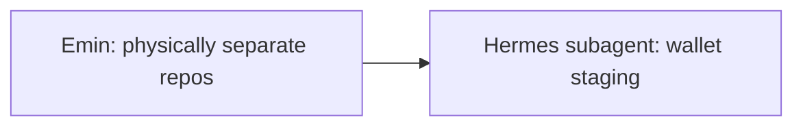

# Prompt log

- 2026-10-16, Emin via Hermes parent → Hermes/Opus 5.5 (signer-wallet parity, code a7e7f189d7c1): "Audit and fix verified
  wallet-to-Signer parity seam omissions. Parent live guest balance claim link resolves wallet-local /bridge/privy rather than
  separate signer … local legacy URLs must stay usable … No push/deploy."
- 2026-10-14, Emin via Hermes parent → Hermes subagent (wallet staging): "Implement physically separate Wallet repository artifact for wallet.paymentrequired.com … no Wirex banking constructor/client credentials … cloud actual boot/fixture probes … no prod or publication." Follow-up: port 8e77eecc only where wallet owns the route; preserve `<db>.chain-<id>` sidecar contract.
- 2026-10-14, Emin via Hermes parent → Hermes subagent (directory-wave consumer fix), input frozen directory-wave copy:
  "Fix actual final-consumer sign-in findings in frozen Banking and Wallet copies … first banking call after already
  delivered broker result returns stale connect_required once … broker_unreachable plain failure … missing
  serveSigningPreparation to explicit 404 … Direct public /mcp stays on owners". Scope approved-scope.md.
- 2026-10-14, Emin via Hermes parent → Hermes subagent (layer optimization): "So can you please deploy and run it? What is
  the problem where you stuck can you just finish the work?" Scope: minimal Dockerfile layer fix for the cloud build inode
  blocker, serial builds on the existing host, image-only QA, no deploy. Approval issue404 comment6171722323.
