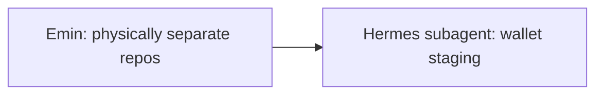

# Prompt log

## 2026-11-24 — Emin; recorded by Antigravity

- **"test it through, with real money, real signing etc. ... just document it well on all repos with links"**
  - Removed all custom SHA-256 tagged-hash / deterministic-nonce code from `nuri-0conf-bitcoin-lightning-fronter/rust/` (`bitcoin::taproot::TapTweakHash::from_key_and_tweak` + `musig2::SecNonceBuilder` OS CSPRNG + SQLite `l1_signed_responses` replay cache) and exposed bearer-authenticated `POST /v1/agent/grants/register`.
  - Verified against real **Bitcoin Core v31.1.0 regtest** consensus (`5`-block CSV: Rust key-path `28839323...` mined, RBF blocked `outpoint_already_signed`, CSV safety guard `csv_timelock_too_close` at age 3; unilateral CSV recovery `2dd6959b...` rejected by Bitcoin Core `non-BIP68-final` at age 4 and mined unmodified at age 5).
  - Verified against **Bitcoin mainnet** with `3,000` real sats sent from `smartcard@nuriwallet.com` (`eb95ec57...:0` → Hop 1 Rust MuSig2 sign + split `2a8acc3a...` → Hop 2 immediate `0-conf` change sweep `a3de1913...` back to Pool L1 hot `bc1pge7p...`; `0` remaining UTXOs; live `/v1/fronter/status` `totalFloatSats: 33,314`, `netFloatEquitySats: 33,237`).
  - Rewrote `nuri-0conf-bitcoin-lightning-fronter/README.md` strictly for the verified present and cross-linked all three repos.

- **"so its fully working in both directions, can you test a few more back and force sendings? ... i am sending another 10k sats"**
  - Root-cause caught live: Emin's `10,000`-sat LN payment (`rfq_id: 5fc86f4a5b74fdf1`, `9,955` gross) was claimed into pool Arkade (`8,667 -> 18,622`), but `claimLightningReceive` aborted on `fronter_l1_pool_insufficient_liquidity` because Pool L1 hot wallet held `1,775` sats (< `10,099` sats payout), hiding the user's credit.
  - Fix (`src/agent-l1-fronter-v2.mjs` + TEST 18, `a9773f7`): pre-broadcast `sendL1Payout` liquidity/fee errors now fall back gracefully to `deferred_l1_credit` (`pending_receive_sats` spendable immediately over LN / auto-swept later), immediately auto-crediting `10,099` sats (`+200` `2%` fee).
  - Live 7-hop `10k` mainnet loop (all directions & paths proven): Hop 1 `smartcard -> local` `9,400` (`micro_credit`, `+188` fee); Hop 2 `local -> smartcard` `1,150` (`l1_0conf_settle` real L1 payout tx `ad0f15dc8b8cc4cd02c02b88c954ce86fb6e02c15760052ff4261c8e6069d509`, `1,295` sats on `bc1pu3r4...`, `+23` fee); Hop 3 `smartcard -> local` `900` (`l1_0conf` immediate **0-conf re-spend** of `ad0f15dc...` via co-signed L1 tx `bf79ee2a75b22874c597e43baba358b1d868421812ab8dacd52a9cdcddfcb058`, `+18` fee); Hops 4–7 bounced `950 -> 800 -> 700 -> 550` (`smartcard`: `225`, `local`: `8,783`).
  - Live 6 additional bidirectional tests (`more6`, `1,500 -> 1,200 -> 1,100 -> 1,000 -> 900 -> 800` sats across `deferred_l1_credit` and `micro_credit`): `+130` sats earned (`smartcard`: `565`, `local`: `8,255`).
  - Final `https://nuriwallet.com/v1/fronter/status` after `more6`: `completedOutSwaps: 12`, `completedInSwaps: 12`, `earnedServiceFeeSats: 705`, `+545` sats net profit (`10,545` equity vs `10,000` initial seed, `totalFloatSats: 11,110`).
- **36-swap `stress20k` mainnet battery + final `11,486`-sat pool sweep (`0087b3b`, `f8215f0`):**
  - Cleaned up stale pre-patch `paying_ln` row (`0087b3b`, TEST 19c) caught immediately on first `stress20k` attempt, then executed all 12 hops cleanly (`14–25s`/hop, 0 errors): `h1` `9,500` (`l1_0conf`, `b611fd77...`), `h2` `420` (`lend`), `h3` `360` (`full_debt`), `h4` `1,500` (`l1_0conf_collect`, `cf783851...`), `h5` `3,500` (`l1_0conf_settle`, `9ef22e8b...`), `h6` `2,500` (`l1_0conf` chained, `aea38e7c...`), `h7` `2,000` (`l1_0conf_settle`, `2d064950...`), `h8` `450` (`lend`), `h9` `1,800` (`partial_debt_l1_settle`, `0af53613...`), `h10` `5,000` (`l1_0conf` multi-in, `c006b7d3...`), `h11` `500` (`micro_credit`), `h12` `400` (`micro_credit`).
  - Swept remaining `11,486` sats from scratch (`83db35ff...`, `0` fee) into Pool Arkade. Final live `/v1/fronter/status`: `completedOutSwaps: 19`, `completedInSwaps: 17`, `earnedServiceFeeSats: 1265`, `totalFloatSats: 30848` (`l1Hot: 12650`, `arkade: 18198`), `netFloatEquitySats: 30771` (`+1,030` net profit vs `29,741` injected), `totalPendingReceiveSats: 77`, `totalDebtSats: 0`.
  - Parallel Rust cosigner (`nuri-l1-cosigner`) built in `nuri-0conf-bitcoin-lightning-fronter/rust/` (`4/4` tests green incl. `@lennard` 0-byte parity).
- **Stress-test failure-mode hardening (`nuri-agent-cosigner` + `wallet-paymentrequired-com`):**
  - Audited for P0/P1/P2 stress failures (before 20k stress run) and shipped surgical fixes: `sendL1Payout` `l1BroadcastAttempted` lock preservation, `sendOnchainBtc` `broadcast_pending` WAL + multi-in debt check, end-to-end 25-ancestor depth cap + `fronter_l1_pool_mempool_chain_full` defer, high-fee net-negative UTXO filter, `createEsploraL1Client` + cosigner `createEsploraUtxoVerifier` 429/5xx backoff + 10s `txCache`, in-flight `lend` guard + refund overflow, `ORDER BY pending_receive_sats DESC`, `to_amount >= 330`, `60s` fee cache, + TEST 21 & 22.
- **"dont forget the changelogs ... yes def. do that [#1 auto-sweep, #2 VHTLC timeout reconciler, #3 RFQ retry] ... ignore 4 & 5 for now"**
  - Answered Arkade VTXO concern cleanly: collaborative offboards/rebalances settle immediately via an Arkade round without hitting the unilateral exit timelock (and refresh VTXOs at the same time).
  - Implemented & tested #1 + #2 + #3 (~100 lines total, zero new services/timers/deps): `sweepDeferredL1Credits` + `sweepAllDeferredL1Credits` inside `startLnurlAutoClaim` (no double fee), `paying_ln` VHTLC timeout auto-reconciler (`LEND` / `micro_credit` / `l1_0conf`), `withRfq` 3x retry, plus TEST 19 & TEST 20 (`20` E2E tests green).
- **"ok into the pool with it for now! ... dont forget the changelogs, and perfect docs on github with the latest state"**
  - Swept remaining `8,255` sats (`7` VTXOs, `0` fee, `arkTxid: 4679ef6cf72a036298de73546cfc6b9483b8706ab57e50f9f70da17ca5cb755a`) from scratch test wallet into Pool Arkade (`localRemainingSats: 0`).
  - Final live pool state (`/v1/fronter/status`): `totalFloatSats: 19,365` (`arkadeBalanceSats: 18,444`, `l1HotBalanceSats: 921`), `netFloatEquitySats: 18,800`, `totalPendingReceiveSats: 565`, `totalDebtSats: 0`, `earnedServiceFeeSats: 705`. All 5 user L1 txs confirmed on mainnet (incl. `ad0f15dc...` + `bf79ee2a...` in block `977404`).
  - Delivered viability assessment vs. Muun (mechanism & unit economics viable; 5 upgrades needed before production scale: auto L1↔Arkade rebalancer + cron sweep, `LEND` VHTLC timeout sweeper, Nostr multi-relay + overflow routing, CPFP bumping, Rust cosigner/vault migration).
- **"send the 1337 to emino ... make a local wallet and send back and forth autonomously"**
  - Fixed live mainnet blocker: `mempool.space/api/fee-estimates` target-3 dropped to `0.812` sat/vB (`esplora_fee_rate_invalid` when `< 1`). Updated `createEsploraL1Client.estimateFeeRate` (`rate > 0` -> `Math.max(1, Math.ceil(rate))`) + added TEST 17 (`bf138b3`).
  - Live mainnet `1,337`-sat proof: Paid `1,337` sats from `smartcard@nuriwallet.com` to `emino@nuri.com` (`lend` mode, preimage `a1bd306e...`, `fee_sats: 32` incl. `+27` `2%` fee); plus `497`-sat inbound (`+10` `2%` fee) auto-triggered `full_debt_plus_micro` (`FulfillFullDebt`, `-373` debt cancelled).
  - Live 6-hop autonomous mainnet ping-pong: Built standalone scratch Arkade+LN wallet (`ark1qzpq904am6clw3pgqwyh4p02708fy4xs0hcpwt7rwfdttuxsjameeqpzepk8flwu44eu4tavgk2f64gj8lwu5p0daq5h8m905thlmyezw8qusk`) and executed 6 automated bidirectional hops (requiring concurrent `Promise.all` `pushClaim` for `@arkade-os/swap` hold invoices): Hop 1 `smartcard -> local` `430` sats (`l1_0conf_collect` real co-signed L1 tx `707619313325e9aa627a358c6df99dfbff1cf2166c91488719f7840441dcbc8b`, clearing `327` debt); Hops 2–6 bounced `419 -> 392 -> 381 -> 360 -> 349` sats via `@nuriwallet.com` + `micro_credit` until reaching the `340`-sat floor.
  - Pool profit verified on `https://nuriwallet.com/v1/fronter/status`: `completedOutSwaps: 5`, `completedInSwaps: 5`, `earnedServiceFeeSats: 86`, `netFloatEquitySats: 10098` (`+95` sats vs `10003` baseline), `totalFloatSats: 10442`, `totalDebtSats: 0`, `totalPendingReceiveSats: 344`.
- **"switch to a muun.com like model where bitcoin is always onchain ... 100% ARKADE on server pool, NOT Spark ... test on paymentrequired.com (nuriwallet.com) without touching nuri.com or arkade.nuri.com"**
  - Decision: Keep user/agent BTC funds solely in `tr(MuSig2(agent, cosigner), pk(agent) + CSV)` on Bitcoin L1 (`src/agent-l1-fronter-v2.mjs`) and run a single server-side Arkade + L1 liquidity pool (`l1_0conf` mode), leaving consumer `app.nuri.com` and `arkade.nuri.com` 100% untouched. Rejected client-side VTXO wallets (too heavy) and raw un-cosigned 0-conf (RBF-vulnerable).
  - Live discovery: `nuri-agent-cosigner` on `46.225.135.119:8794` runs `blocks: 4320` (~30d), so `wallet-paymentrequired-com` live-syncs CSV & network from cosigner `/healthz` for byte-identical `bc1p...` addresses; also verified 0-byte divergence vs live mainnet `@lennard` (`app.nuri.com`).
- **"can we use connected smartcard via cli without extension ... keep skill.md simple/passkey-first ... auto-assign nuriwallet.com LNURL ... keep nuri.com vs nuriwallet.com strictly separate"**
  - Decision: Built `nuricard connect` CLI over PC/SC + USB-HID (`nuri-com/nuri-passkey-prf-smartcard`) while keeping `/skill.md` dead-simple browser-Passkey-first (`1acfe9e`). Auto-assigned deterministic 6-letter `@nuriwallet.com` LNURLs (`64e8819`) inside `wallet.sqlite` (zero calls to `arkade.nuri.com`) and registered `smartcard@nuriwallet.com`.
- **"send Lightning to emino@nuri.com (real L1 tx) ... explain Muun 1-sat ... add 2% both ways + monitor endpoint (park SwapKit overflow for later)"**
  - Live mainnet proof: Sent `1,000` sats to `emino@nuri.com` (`preimage 62efae23...`, L1 tx `e32a6b14...` paying `1,007` sats to pool L1 + `997` sats 0-conf trusted change); received `1,001` sats via `smartcard@nuriwallet.com` (`996` sats net credit).
  - Decision: Verified Muun `libwallet` (`incoming_swap.go`, `fees/fees.go`) never broadcasts sub-dust 1-sat L1 outputs (`FulfillFullDebt` + `OutputPadding`); added `FRONTER_RECEIVE_FEE_BPS` (`2%` in & out), `earnedServiceFeeSats` tracking, `btc_unconfirmed_sats`, and `GET /v1/fronter/status`. Parked SwapKit/BitcoinVN overflow rebalancing for later.

## 2026-11-23 — Emin; recorded by Antigravity

- "tell me if i can just fund base usdc or arkade and you then do the rest ... keep base usdc but
  tempo mpp still works auto ... can we not test the tempo payment and the treg.to?" → added
  Relay Base USDC (and Arkade → Base USDC) → Tempo (`4217`) Agent EOA auto-bridge with strict
  calldata/fee verification, `$0.03` Tempo EOA fee buffer, Agent EOA balance reuse, and README
  update.
- Live `treg.to` MPP test hit `feeToken is not defined` on Tempo Safe deploy and ran a hop for
  treg's free `amount: "0"` EIP-712 proof challenge → fixed `ensureSafeDeployed(..., feeToken)`,
  added `readTokenBalanceUnits`, skipped hops on `amount === 0`, and added two-step MPP
  `402 credit_insufficient` retry with cap & Tempo balance checks.
- "why are these links expiring so fast can they please stay valid for at least 1 hour or more ...
  after fixing, also please update the changelog and github repo for it" → `startOrPollOnboarding`
  omitted `timeoutMs`, falling back to Connect's 60-minute default; now passes 24 h
  (`DEFAULT_GRANT_CONNECT_TIMEOUT_MS`, overridable via `PRF_GRANT_CONNECT_TIMEOUT_MS`) and fixes
  `parseSessionExpiresAtMs` for `expires_at: 0` no-deadline sessions.

## 2026-11-20 — Emin; recorded by Hermes

- "I need to get support for MPP tempo. For some reason our wallet can't do it." → Tempo MPP
  from the PRF Safe (PR #23): found the Base-only offer filter, chain table and hardcoded
  chainId; verified the Gnosis Safe singleton/factory live on both Tempo chains.
- "run the LNURL for the agent wallet and we use the domain nuriwallet.com" → nuriwallet.com
  LNURL handles (PR #24 + #25): read agent-arkade-v2's RFQ receive path first ("it always
  ends up inside Arkade"), registered `goose@nuriwallet.com` live, minted a real invoice.

## 2026-10-17 — Emin; recorded by Hermes

- "tldr explain what confused the model, then fix it, then test it again, is it clear that there is a split between banking, wallet, signer etc.?"

- 2026-10-16, source Emin via Hermes parent; implementer Hermes/GPT-6.1: issue #404, fix only P1 durable record-only
  guest owner plus encrypted box before adoption/ACK and P2 complete-scan caller cancellation/deadline propagation.
  Code `8bccca2040c825f3041c735eb44ad089be30c48a`, committed 2026-10-16T04:06:48+02:00
  (`src/mcp-agent-wallet.mjs:394-416`, `src/browser-bridge.mjs:484-543`, `src/signer-broker-hook.mjs:88-186`).
  Signer 19f2c45 retained; Wallet source only. No Mac product execution, new tests, secrets/provider/payment/activation,
  SSH, prod, push or PR. Static diff check passed; runtime/cloud correctness UNVERIFIED. Parent reviews and owns release.
- 2026-10-16, source Emin via Hermes parent; implementer Hermes/GPT-6.1 (Opus route exhausted): resolve timestamp ties/
  clock regression, five-minute ciphertext loss versus guest links, and local expiry recovery; coordinate owned Wallet
  and Signer endpoints, preserve approvedAt expiry/bindings/signatures/guest-key handover, historical ties fail closed.
  Source-only; no Mac product execution, new tests/dependencies, Banking edits, push or deploy. Code
  `e06df06c12e0d5e35b4631ca9866fdfb65c63ee8` (2026-10-16T03:33:17+02:00): persisted broker-order election and expired
  guest descriptor recovery (`src/signer-broker-hook.mjs:117-168`, `src/browser-session-store.mjs:51-73`,
  `src/browser-bridge.mjs:662-670,718-721`, `src/mcp-connection.mjs:285-290,346-350`). Cloud/runtime/full parity UNVERIFIED.
- 2026-10-16, source Emin via Hermes parent; implementer Hermes/Opus 5.5; Wallet parity v3,
  code b986f09a8a43a669140cf8c6c61618a65c78b4bb: "No arbitrary newest-32 window; earliest successful tap, not oldest
  link creation; verify broker approvedAt; bounded broker response latency and stop repeated outage calls; do not hide
  unreadable potentially-earlier submitted results. Source-only, Wallet clone only, no Mac product execution or deploy."
  Implemented uncapped discovery, two-pass timestamp election shared by entry points, same-wallet in-flight coalescing,
  3 s HTTP/body deadline and 5 s client failure backoff (`src/browser-session-store.mjs:52-61`,
  `src/signer-broker-hook.mjs:94-97,117-166`, `src/root-signer-client.mjs:14-54`). Full parity NOT claimed: equal
  millisecond approvals and broker's 300 s result loss need a concrete signer contract decision (sibling
  `paymentrequired-signer/src/root-signer-store.mjs:25,33,53-54`, `paymentrequired-signer/src/root-signer-envelope.mjs:17`).
  Tests/build/runtime UNVERIFIED; parent cloud gates own execution. No new schemas, dependencies or public tool fields.
- 2026-10-16, Emin via Hermes parent → Hermes/Opus 5.5 (wallet follow-up, code 9e9fe4677558): "Repair the acknowledged parity
  hole: RAM-only claimLinks loses previously issued broker claim results after restart or when a newer balance link replaces it …
  Reuse persisted bridge connection rows/context.walletId … no new store/schema … No push/deploy."
- 2026-10-16, Emin via Hermes parent → Hermes/Opus 5.5 (signer-wallet parity, code a7e7f189d7c1): "Audit and fix verified
  wallet-to-Signer parity seam omissions. Parent live guest balance claim link resolves wallet-local /bridge/privy rather than
  separate signer … local legacy URLs must stay usable … No push/deploy."
- 2026-10-14, Emin via Hermes parent → Hermes subagent (wallet staging): "Implement physically separate Wallet repository artifact for wallet.paymentrequired.com … no Wirex banking constructor/client credentials … cloud actual boot/fixture probes … no prod or publication." Follow-up: port 8e77eecc only where wallet owns the route; preserve `<db>.chain-<id>` sidecar contract.
- 2026-10-14, Emin via Hermes parent → Hermes subagent (directory-wave consumer fix), input frozen directory-wave copy:
  "Fix actual final-consumer sign-in findings in frozen Banking and Wallet copies … first banking call after already
  delivered broker result returns stale connect_required once … broker_unreachable plain failure … missing
  serveSigningPreparation to explicit 404 … Direct public /mcp stays on owners". Scope approved-scope.md.
- 2026-10-14, Emin via Hermes parent → Hermes subagent (layer optimization): "So can you please deploy and run it? What is
  the problem where you stuck can you just finish the work?" Scope: minimal Dockerfile layer fix for the cloud build inode
  blocker, serial builds on the existing host, image-only QA, no deploy. Approval issue404 comment6171722323.
