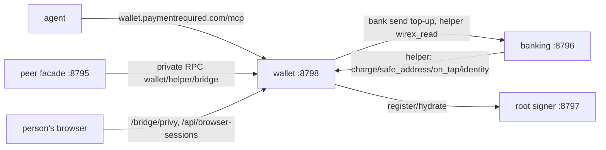

# paymentrequired wallet service

The wallet service of paymentrequired.com, served at `wallet.paymentrequired.com`. It runs the
`wallet` MCP tool (`src/mcp-wallet-tool.mjs`): balance, fund, pay, ask, send, history, bridge,
discover. The agent Safe is the payer. It holds no Wirex client and no Wirex credentials. Card,
IBAN, account and bank-root payments belong to the banking service.



## Run

```bash
npm ci && npm run build:privy      # public/privy-bridge.js (build-only deps)
cp .env.example .env               # fill the custody values; never commit .env
npm start                          # node src/wallet-server.mjs
npm run check                      # node --check every module + import-closure check
```

Boot refuses when:
- `SERVICE_MODE` is anything other than `wallet` (`src/wallet-server.mjs:42`)
- any of `WIREX_TOKEN_URL`, `WIREX_COMPANY_ID`, `WIREX_CLIENT_ID` or `WIREX_CLIENT_SECRET` is set (`src/service-mode.mjs:24-28`)
- an agent custody value is missing (`src/server-boot-check.mjs:6-15`)
- `SERVICE_RPC_SECRET` is shorter than 32 characters (`src/service-rpc.mjs:22`)

## Ask AI from the agent wallet

One `wallet` tool call (`src/mcp-wallet-tool.mjs`, `ask`):

```json
{"action":"ask","wallet_key":"<your wallet_key>","prompt":"Explain x402 in one sentence.","max_amount":"0.05","quality":"fast","request_id":"explain-x402-1"}
```

Returns `answer`, `cost` (USDC), `model`, `receipt` and `request_id`, plus `ok`.
`quality` defaults to `fast`; `smart` selects the other model in `ASK_MODELS`.
The fixed router URL receives a non-streaming POST. It generates an answer, returns its
exact x402 invoice, then releases the answer after the existing wallet pay transport settles it.
No preflight generation and no new signing implementation.

Supply `request_id` before spending. Retry with the same ID and unchanged fields, including
the cap; the durable payment journal prevents a second payment, including after a restart.
An over-cap invoice signs and pays nothing: **send again with a NEW request_id and a higher
max_amount**. The rejected operation remains final; changing its cap conflicts with its binding.
If the paid response body was lost, same-ID replay reads the router's retained answer without
another payment signature (`src/agent-kernel-runtime.mjs`).

Offline checks (Node 22, no wallet credentials or network): `npm run check:ask` and
`npm run check:ask:regression`. They exercise the real x402 parsing/signing and durable journal
against a fake router, RPC, signer, Kernel account and wallet-credential adapter. CI runs these
on GitHub-hosted runners; no live payment or deployment is part of the checks.

## Surface

| Route | Source |
|---|---|
| `POST /mcp`: `initialize`, `tools/list` (= `wallet`), `tools/call` | `src/wallet-server.mjs:257-301` |
| `POST /rpc/tool` (loopback, bearer `SERVICE_RPC_SECRET`) | `src/service-rpc.mjs:21-45`, `src/wallet-server.mjs:120-154` |
| `GET /healthz` | `src/wallet-server.mjs:173-176` |
| `GET /` role page | `src/service-index.mjs:6-10` |
| `GET /bridge/privy`, `/bridge/privy/wirex`, `/bridge/privy.js` | `src/wallet-server.mjs:178-187` |
| `/api/browser-sessions/<id>[/approval\|/callback\|/connection]`, `/pending` | `src/wallet-server.mjs:188-234` |
| `GET/POST /s`, `GET /short-link.mjs` | `src/wallet-server.mjs:166-171` |

Public MCP endpoint: `https://wallet.paymentrequired.com/mcp` (catalog `wallet`,
`src/wallet-server.mjs:235,257-301`); connect links use the existing root signer broker
(`src/wallet-server.mjs:114-118`). Docs and llms files stay on the apex (`src/service-index.mjs:52-53`);
the apex `/mcp` no longer serves tools (approved-scope.md, 2026-10-14).

See `ARCHITECTURE.md` (owned stores, peers, peer-down behaviour), `DEPLOY.md` (image, mounts,
env), and `EXTRACTION.md` (what came from the monolith, and why).
