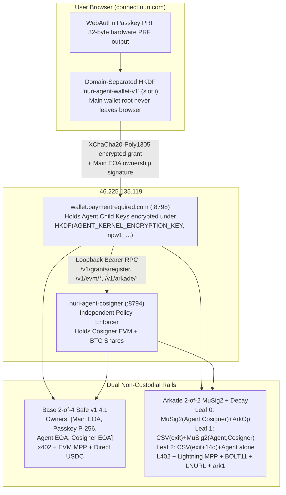

# Custody Evolution: Privy + ZeroDev v1 to Vendor-Independent Nuri Passkey PRF v2

This document preserves the complete architecture of the **v1 Privy + ZeroDev Kernel** agent wallet custody design, explains how all existing v1 wallets remain 100% live in place, and details how **v2 Nuri Passkey PRF** achieves full vendor independence across both **Base USDC (2-of-4 Safe)** and **Bitcoin Lightning / Arkade (2-of-2 MuSig2)**.

---

## 1. Where We Came From: Custody v1 (`nuri-privy-app-2of2`)

### 1.1 Why v1 Was Built This Way
When `wallet.paymentrequired.com` launched, AI agents needed an immediate, zero-friction Base USDC wallet (`wallet_key`) that:
1. Worked instantly for an unauthenticated guest agent (`44`-character base64url `wallet_key`),
2. Could later be claimed in one browser tap by a human owner via Privy (`66`-character base64url `wallet_key`), and
3. Never gave the server unilateral custody over connected user funds.

### 1.2 How v1 Works Under the Hood (Preserved Live)
All v1 code remains intact and active for existing bearer keys:

- **Entry & Routing**:
  - `src/mcp-wallet-tool.mjs`: Routes `44`-char and `66`-char `wallet_key` tokens (and `session`-scoped calls) to `createMcpAgentWallet` (`src/mcp-agent-wallet.mjs`).
  - `src/browser-bridge.mjs` + `public/privy-bridge.jsx` + `src/signer-broker-hook.mjs`: Serves `/bridge/privy` and coordinates browser claim ceremonies with `signer.paymentrequired.com` (`127.0.0.1:8797`).
- **2-of-2 Privy Quorum Signer (`src/privy-agent-app-signer.mjs`)**:
  - Uses `@privy-io/node` (`PRIVY_AGENT_APP_ID`, `PRIVY_AGENT_APP_SECRET`, `PRIVY_AGENT_AUTHORIZATION_PRIVATE_KEY`) to hold the server half of a 2-of-2 quorum key inside Privy's enclave.
  - The caller's `wallet_key` carries (or unlocks after claim) the client half scalar, so neither the wallet server nor Privy can sign without the caller's `wallet_key`.
- **Smart Account Runtime (`src/agent-kernel-wallet.mjs`, `src/agent-kernel-runtime.mjs`)**:
  - Provisions smart accounts via ZeroDev SDK (`@zerodev/sdk`, `@zerodev/ecdsa-validator`, `@zerodev/permissions`) and Safe smart account primitives on Base (`chainId = 8453`) with Circle Gateway multi-chain sidecars (`wallet.sqlite.chain-<id>`).
  - Settles HTTP 402 `x402` (`exact` EIP-3009 and `exact`/`upto` Permit2 via ERC-1271) and EVM `MPP` (`WWW-Authenticate: Payment`, `mppx` / Tempo) with durable SQLite journals (`agent_kernel_alpha_ops`, `agent_kernel_alpha_txs`, `agent_kernel_alpha_budget`).
- **Live State Coexistence**:
  - Existing v1 tables (`agent_wallets`, `agent_kernel_wallets`, `agent_kernel_access`, `agent_kernel_alpha_*`) in `/var/lib/nuri-wallet/wallet.sqlite` are untouched.
  - Any agent presenting a `44`-char or `66`-char `wallet_key`—or any private loopback `/rpc/tool` call from `banking` (`:8796`) or `facade` (`:8795`) referencing a v1 wallet—executes the exact v1 path without migration friction.

### 1.3 Limitations of v1 That Motivated v2
1. **Third-Party SaaS Custody Dependency**: Relied on Privy's hosted API (`@privy-io/node` + `@privy-io/react-auth`) and ZeroDev SDK for wallet creation and signing quorum.
2. **EVM-Only**: Could not hold Bitcoin VTXOs or pay/receive Lightning (`BOLT11`, `L402`, Lightning `MPP`, `LNURL-pay`).
3. **Separate Identity Silo**: Users who already owned a Nuri Passkey (`connect.nuri.com`) had to go through a separate Privy flow instead of deriving an isolated agent sub-wallet directly from their Nuri Passkey hardware PRF.
4. **9-Action Surface**: Exposed 9 overlapping actions (`balance`, `fund`, `pay`, `ask`, `send`, `history`, `bridge`, `discover`), increasing tool-selection cognitive load for smaller LLMs.

---

## 2. Where We Are Now: Custody v2 (`nuri-agent-wallet-v1`)

Custody v2 eliminates every external custody SaaS dependency for new wallets while adding native Bitcoin Lightning + Arkade alongside Base USDC.

### 2.1 Vendor Independence & Sovereign Recovery Guarantees

| Property | v1 (`Privy + ZeroDev`) | v2 (`Nuri Passkey PRF`) |
|---|---|---|
| Bearer token format | `44` or `66` base64url chars | `npw1_<43 base64url chars>` (`48` chars total) |
| Onboarding ceremony | `/bridge/privy` (`@privy-io/react-auth`) | `connect.nuri.com` (`operation: "agent_grant"`) |
| Main wallet root exposure | Separate Privy root | **Zero** — domain-separated `'nuri-agent-wallet-v1'` derived inside browser RAM |
| Random session keys? | Yes (sealed in key boxes) | **Never** — 100% deterministic from Passkey PRF + `slot_index` |
| EVM account | ZeroDev Kernel / Privy 2-of-2 Safe | Canonical **Safe v1.4.1 L2 (2-of-4)** predicted offline via `CREATE2` |
| EVM recovery if server & cosigner vanish | Requires Privy enclave | User signs `2-of-4` directly with `[Main EOA + Passkey Daimo P-256 Signer]` |
| Bitcoin / Lightning custody | None | **Arkade 2-of-2 MuSig2** (`NuriAgentVtxoScript`) + trustless Arkade Intents VHTLCs |
| BTC recovery if cosigner vanishes | N/A | **Leaf 2 Server-Decay**: after `exitTimelock + 14 days`, user re-derives `agentClientKey` from Passkey PRF and sweeps unilaterally on Bitcoin L1 |
| Lightning swap engine | None | `@arkade-os/swap` RFQ/VHTLC over Nostr (`wss://nostr.arkade.sh`) — **zero Boltz** |

### 2.2 Policy Co-Signing Without Custodial Lock-In
`nuri-agent-cosigner` (`127.0.0.1:8794`) holds deterministic per-grant cosigner keys derived via HKDF from its 32-byte master seed and `(cred_id_b64u, slot_index)`:
1. **Normal agent operation**: `wallet.paymentrequired.com` signs with the Agent child key and requests a policy-checked co-signature from `nuri-agent-cosigner` (`Agent + Cosigner = 2-of-4` on Base Safe; `MuSig2(Agent, Cosigner)` on Arkade).
2. **Independent policy enforcement**: `nuri-agent-cosigner` decodes Safe transactions, EIP-3009 / Permit2 typed data, and Arkade PSBTs + VHTLC scripts independently, enforcing per-tx and daily USDC/sats caps before co-signing.
3. **Zero lock-in**:
   - On **Base**, the user owns 2 of the 4 Safe owners (`Main EOA` + `Passkey P-256 Signer`) and can execute any Safe transaction, revoke `Agent EOA` / `Cosigner EOA`, or sweep all USDC without `wallet.paymentrequired.com` or `nuri-agent-cosigner`.
   - On **Bitcoin / Arkade**, every VTXO commits to a 3-leaf Taproot tree whose 3rd leaf drops the cosigner key after `unilateralExitDelay + 1,209,600s` (14 days), letting the user recover 100% of sats from their Passkey PRF alone.

---

## 3. Collapsed 4-Action Public MCP Surface

To maximize reliability across frontier and small tool-calling models, the public `wallet` MCP tool schema (`WALLET_TOOL` in `src/mcp-wallet-tool.mjs`) exposes **4 actions**:

1. **`balance`** — Connect a Nuri Passkey wallet (when called with no `wallet_key` or `new: true`), poll onboarding completion (`request_id`), auto-sweep paid incoming Lightning VHTLCs into 2-of-2 Arkade custody, and return dual balances (`available` USDC + `sats` / `btc`, `address` + `arkade_address`).
2. **`receive`** — Return deposit coordinates for `rail: "usdc"` (Base Safe `0x...`), `rail: "arkade"` (`ark1...`), or `rail: "lightning"` (trustless BOLT11 invoice via Arkade Intents VHTLC for `amount_sats`).
3. **`pay`** — Unified payer and sender:
   - `url`: Auto-detects and pays HTTP 402 challenges across **all 4 protocols**: `L402`/`LSAT` (Lightning), `MPP` Lightning (`WWW-Authenticate: Payment` `method="lightning"`), `x402` (`PAYMENT-REQUIRED` EIP-3009 / Permit2), and `MPP` EVM (`method="evm"`), with `dry_run` inspection and `prefer` rail selection.
   - `invoice`: Pays a `BOLT11` Lightning invoice (`lnbc...`) via Arkade Intents VHTLC and returns the cryptographic `preimage`.
   - `to`: Sends to a **Lightning Address** (`user@domain.com` via LNURL-pay), a native **Arkade address** (`ark1...` / `tark1...`), or a **Base EVM address** (`0x...` USDC).
4. **`history`** — Returns chronological operations across both `usdc`, `lightning`, and `arkade` rails.

*(Backward-compatibility note: legacy callers still invoking `fund`, `send`, `ask`, `bridge`, or `discover` on `tools/call` or internal `/rpc/tool` continue to work transparently.)*
